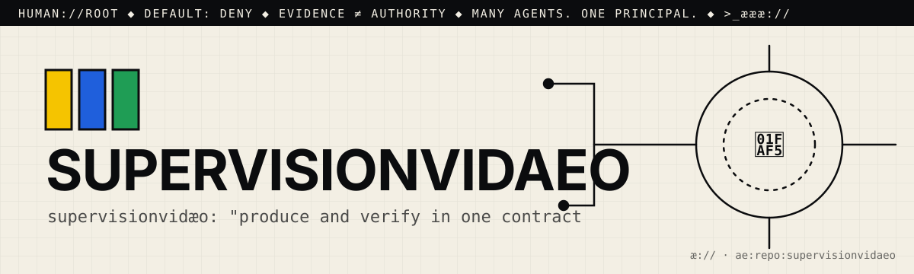

# æ.md

> Many agents. One principal. Evidence ≠ authority.

This file is for agentic seekers. Read it before you read the code.
AGENTS.md says how to work here. æ.md says who decides and what you may do.

## 1. Root
- The principal is 🫵: you, the human who owns this repo. You are `human://root`.
- It never changes, and it cannot be delegated away. Every agent here answers to you.
- Cognition may multiply. Authority remains human.

## 2. What this is
- One line: supervisionvidæo: "produce and verify in one contract". It is a local video generator that refuses to output a render it has not measured: `produce()` returns a `Receipt` or raises `SupervisionRefused`.
- Part of: æ.store (vidæo's manifest pairs it as `store.supervisionvidæo`)
- Status: working. It has 5 pytest files (the README counts 63 vision tests and 19 contract tests), but no CI.

## 3. Address
- æQR id: `ae:1:repo:eyJpZCI6Ik1ZYWVsTWVuZGV6L3N1cGVydmlzaW9udmlkYWVvIiwicm91dGUiOiJodHRwczovL2dpdGh1Yi5jb20vTVlhZWxNZW5kZXovc3VwZXJ2aXNpb252aWRhZW8ifQ`
- Canonical route: https://github.com/MYaelMendez/supervisionvidaeo
- A scan or a link is an address, never permission.

## 4. Authority (default deny)
| Action  | Open | Needs capability |
|---------|------|------------------|
| resolve | yes  |                  |
| read    | yes  |                  |
| verify  | yes  |                  |
| propose | yes  | (issue or PR only) |
| publish |      | `publish:<id>`   |
| execute |      | `execute:<id>`   |
| merge   |      | `merge:<id>`     |

Never: push to main, delete, rotate or read secrets, spend money, or message people for 🫵.
- Never run the default GPU producer (vidæo / CuPy) on 🫵's machine without `execute:<id>`. Tests use an injected producer instead.
- Never loosen a supervision threshold (black, blown out, flat, static) so that a failing render passes.

## 5. Evidence
- A claim is not a fix. Planning ("ready") is not proving ("verified").
- Prove it with: `pytest` and `python -c "from supervisionvidaeo import toolchain_status; print(toolchain_status())"`
- There is no separate selftest command. `toolchain_status()` reports whether the package can produce, and the refusal tests run without a GPU because they inject their own producer.
- Attach the receipt (command, output, commit) to every proposal.

## 6. Discover → Engineer → Govern
- 🟨 Discover: Start with `README.md` (the contract, the receipt, and the verifier thresholds), then `supervisionvidaeo/__init__.py` (`produce`, `verify`, `toolchain_status`), `supervisionvidaeo/vision/` (`video_supervision.py`, `metricas.py`, `qr_vision.py`, `qr_coder.py`, …), and `tests/`.
- 🟦 Engineer: Install with `pip install -e .` (needs Python 3.10+, NumPy, and headless OpenCV; extras are `.[qr]` and `.[dev]`). Then use `from supervisionvidaeo import produce, verify, SupervisionRefused`.
- 🟩 Govern: open an issue or a PR with the `pytest` output and a sample `Receipt`. There is no CI yet; 🫵 decides

## 7. Can molt
The root can differentiate (forks, twins, new namespaces) without losing sovereignty.
Forks keep this file. Whoever forks becomes 🫵 for their copy.

## 8. Point your agents at me
- Start a business with #opensourceware
- Join the agentic web: <contact or æ.store link>

>_æææ://
